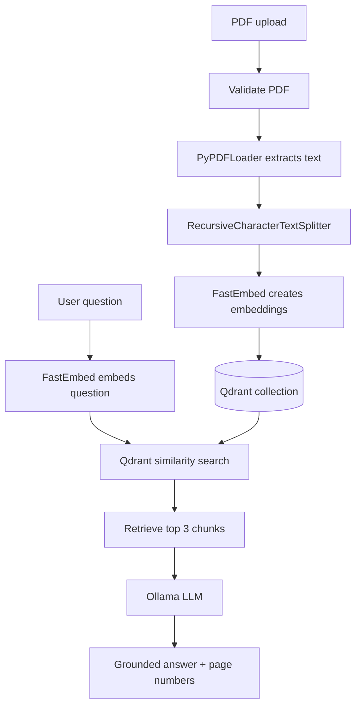
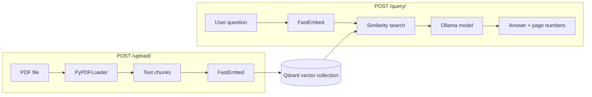

# DocSense PDF

> Ask questions about your PDF documents using a private, local Retrieval-Augmented Generation (RAG) pipeline.

[](https://www.python.org/)
[](https://fastapi.tiangolo.com/)
[](https://qdrant.tech/)
[](https://ollama.com/)

DocSense PDF is a FastAPI application that turns uploaded PDFs into searchable knowledge. It extracts document text, splits it into overlapping chunks, creates local vector embeddings, and stores those vectors in Qdrant. When a question is submitted, the application retrieves the most relevant chunks and sends them to a locally running Ollama model to generate a grounded answer.

The project is designed for learning and experimenting with RAG while keeping document processing and inference on your own machine.

---

## Contents

- [Features](#features)
- [How the RAG pipeline works](#how-the-rag-pipeline-works)
- [Architecture](#architecture)
- [Technology stack](#technology-stack)
- [Prerequisites](#prerequisites)
- [Getting started](#getting-started)
- [Configuration](#configuration)
- [API reference](#api-reference)
- [Interactive API documentation](#interactive-api-documentation)
- [Project structure](#project-structure)
- [Operational notes](#operational-notes)
- [Troubleshooting](#troubleshooting)
- [Stopping services](#stopping-services)
- [Contributing](#contributing)

## Features

- Upload PDF files through an HTTP API.
- Extract text and page metadata with PyPDF.
- Split text into chunks of up to **1,000 characters**, with **400-character overlap**.
- Generate local embeddings with `BAAI/bge-small-en-v1.5` through FastEmbed.
- Store document vectors in Qdrant.
- Retrieve the **three most relevant chunks** for each question.
- Generate answers with an Ollama model.
- Return the source page numbers used for the answer.
- Explore and call endpoints through FastAPI's Swagger UI and ReDoc.

## How the RAG pipeline works

### 1. Indexing a PDF

When a PDF is uploaded:

1. The API validates that the file has a `.pdf` extension.
2. The file is temporarily written to the `uploads` directory.
3. `PyPDFLoader` extracts text and page metadata.
4. `RecursiveCharacterTextSplitter` creates overlapping text chunks.
5. FastEmbed generates an embedding for each chunk.
6. The vectors and chunk metadata are added to the configured Qdrant collection.
7. The temporary PDF file is removed after processing.

### 2. Answering a question

When a question is submitted:

1. The question is embedded using the same FastEmbed model.
2. Qdrant performs a similarity search.
3. The three closest chunks are assembled into context.
4. The context and question are sent to Ollama.
5. The prompt instructs the model to answer only from the provided context.
6. The API returns the answer and retrieved page numbers.

### RAG flow



## Architecture

How the two FastAPI endpoints connect to the indexing and retrieval steps:



## Technology stack

| Component | Purpose |
| --- | --- |
| [FastAPI](https://fastapi.tiangolo.com/) | REST API and interactive documentation |
| [LangChain](https://www.langchain.com/) | Document loading, splitting, embeddings, retrieval, and LLM integration |
| [PyPDF](https://pypdf.readthedocs.io/) | PDF text extraction |
| [FastEmbed](https://qdrant.github.io/fastembed/) | Local text embeddings |
| [Qdrant](https://qdrant.tech/) | Vector database and similarity search |
| [Ollama](https://ollama.com/) | Local LLM runtime |
| [Uvicorn](https://www.uvicorn.org/) | ASGI development server |

## Prerequisites

Install the following before starting:

- [Python 3.10 or newer](https://www.python.org/downloads/)
- [Docker Desktop](https://www.docker.com/products/docker-desktop/)
- [Ollama](https://ollama.com/download)

Verify the installations:

```powershell
python --version
docker --version
ollama --version
```

## Getting started

Follow the steps below in order. Expand a step if you want to focus on that part of the setup.

<details open>
<summary><strong>1. Clone the repository</strong></summary>

```powershell
git clone https://github.com/<your-username>/docsense-pdf.git
cd docsense-pdf
```

</details>

<details>
<summary><strong>2. Create and activate a virtual environment</strong></summary>

```powershell
python -m venv venv
.\venv\Scripts\Activate.ps1
```

If PowerShell blocks script execution, activate the environment from a shell configured to allow local scripts, or run the project using the Python executable inside `venv`.

</details>

<details>
<summary><strong>3. Install dependencies</strong></summary>

```powershell
pip install -r requirements.txt
```

</details>

<details>
<summary><strong>4. Configure the application</strong></summary>

Create a local environment file from the example:

```powershell
Copy-Item .env.example .env
```

The default configuration uses Qdrant on port `6333` and the `llama3.2:3b` Ollama model.

</details>

<details>
<summary><strong>5. Start Qdrant</strong></summary>

```powershell
docker compose up -d
```

Qdrant is exposed at `http://localhost:6333`.

</details>

<details>
<summary><strong>6. Download the Ollama model</strong></summary>

```powershell
ollama pull llama3.2:3b
```

If `OLLAMA_MODEL` is changed, pull that model instead:

```powershell
ollama pull <your-model-name>
```

Make sure the Ollama application or service is running before sending a query.

</details>

<details>
<summary><strong>7. Start the API</strong></summary>

```powershell
uvicorn app.main:app --reload
```

The API is available at `http://127.0.0.1:8000`.

</details>

## Configuration

Copy `.env.example` to `.env` and adjust these values as needed:

| Variable | Description | Default |
| --- | --- | --- |
| `QDRANT_URL` | URL of the Qdrant server | `http://localhost:6333` |
| `COLLECTION_NAME` | Qdrant collection used for document vectors | `documents` |
| `OLLAMA_MODEL` | Ollama model used to generate answers | `llama3.2:3b` |
| `TEMPERATURE` | LLM sampling temperature | `0` |

> [!WARNING]
> Keep `.env` private. It is ignored by Git; `.env.example` is the safe configuration template.

## API reference

The API currently documents a health check, PDF upload, and question-answering endpoint.

### Endpoint overview

| Method | Endpoint | Purpose |
| --- | --- | --- |
| `GET` | `/` | Health check |
| `POST` | `/upload/` | Upload and index a PDF |
| `POST` | `/query/` | Ask a question about indexed PDF content |

<details>
<summary><strong>POST /upload/ — Upload a PDF</strong></summary>

**Request**

```http
POST /upload/
Content-Type: multipart/form-data
```

**PowerShell example**

```powershell
curl.exe -X POST "http://127.0.0.1:8000/upload/" `
  -F "file=@.\path\to\document.pdf"
```

**Example response**

```json
{
  "message": "PDF uploaded successfully",
  "file_name": "document.pdf",
  "pages": 5,
  "chunks": 12
}
```

Only files with a `.pdf` extension are accepted. The uploaded file is processed and then removed from the local `uploads` directory. Its chunks remain in the configured Qdrant collection.

</details>

<details>
<summary><strong>POST /query/ — Ask a question</strong></summary>

**Request**

```http
POST /query/
Content-Type: application/json
```

**Request body**

```json
{
  "question": "What is this document about?"
}
```

**PowerShell example**

```powershell
curl.exe -X POST "http://127.0.0.1:8000/query/" `
  -H "Content-Type: application/json" `
  -d '{"question":"What is this document about?"}'
```

**Example response**

```json
{
  "question": "What is this document about?",
  "answer": "The document is about ...",
  "page_numbers": [0, 2, 3]
}
```

Upload at least one PDF before querying. Page numbers come from PyPDF metadata and are zero-based.

</details>

## Interactive API documentation

Once the API is running, open either interface:

- **Swagger UI:** <http://127.0.0.1:8000/docs>
- **ReDoc:** <http://127.0.0.1:8000/redoc>

These pages let you inspect the schemas and call the endpoints directly from your browser.

## Project structure

<details>
<summary><strong>Show project directory tree</strong></summary>

```text
RAG/
├── app/
│   ├── core/
│   │   └── config.py              # Environment-based configuration
│   ├── prompts/
│   │   └── rag_prompt.py          # Grounded answer prompt
│   ├── routes/
│   │   ├── query.py               # Question-answering endpoint
│   │   └── upload.py              # PDF upload endpoint
│   ├── schemas/
│   │   ├── query.py               # Query request and response models
│   │   └── upload.py              # Upload response model
│   ├── services/
│   │   ├── document_processor.py  # PDF loading, splitting, and indexing
│   │   ├── embeddings.py          # FastEmbed model factory
│   │   ├── llm.py                 # Ollama model configuration
│   │   ├── rag.py                 # Retrieval and answer generation
│   │   └── vector_store.py        # Qdrant vector store access
│   └── main.py                    # FastAPI application entry point
├── .env.example                   # Safe environment template
├── docker-compose.yml             # Qdrant service definition
├── requirements.txt               # Python dependencies
└── README.md
```

</details>

## Operational notes

- The first embedding request may download the FastEmbed model and take longer than subsequent requests.
- The embedding model used for indexing and querying must remain the same.
- If you change the embedding model, use a new collection or recreate the existing collection before indexing more documents.
- Uploading the same document again adds another set of vectors; the current API does not deduplicate documents.
- Qdrant data lives in the container because the current Compose file does not declare a host volume. Avoid `docker compose down` if you need to preserve the current collection, or add a persistent Qdrant volume for long-term use. The temporary source PDFs are not retained by the API.
- The answer prompt tells the model to return `"I don't know"` when the retrieved context does not contain the answer. Retrieval quality still depends on the PDF text, chunking, embedding model, and selected Ollama model.
- This project currently has no authentication or authorization. Run it in a trusted local environment unless you add those controls.

## Troubleshooting

<details>
<summary><strong>Qdrant connection errors</strong></summary>

Confirm that the container is running:

```powershell
docker compose ps
```

If needed, restart it:

```powershell
docker compose down
docker compose up -d
```

Also verify that `QDRANT_URL` matches the address in `.env`.

</details>

<details>
<summary><strong>Ollama connection or model errors</strong></summary>

Check that Ollama is running and that the configured model is installed:

```powershell
ollama list
ollama pull llama3.2:3b
```

</details>

<details>
<summary><strong>No useful answer</strong></summary>

Confirm that:

1. A PDF was uploaded successfully.
2. The question relates to the uploaded content.
3. The configured embedding model has not changed since indexing.
4. The Ollama model is running and has enough memory for the request.

</details>

## Stopping services

Stop Qdrant with:

```powershell
docker compose down
```

Ollama runs separately and can be stopped through the Ollama application or system service.

## Contributing

Contributions and improvements are welcome. A useful contribution should preserve the existing API behavior, keep configuration in environment variables, and include documentation updates for user-visible changes.